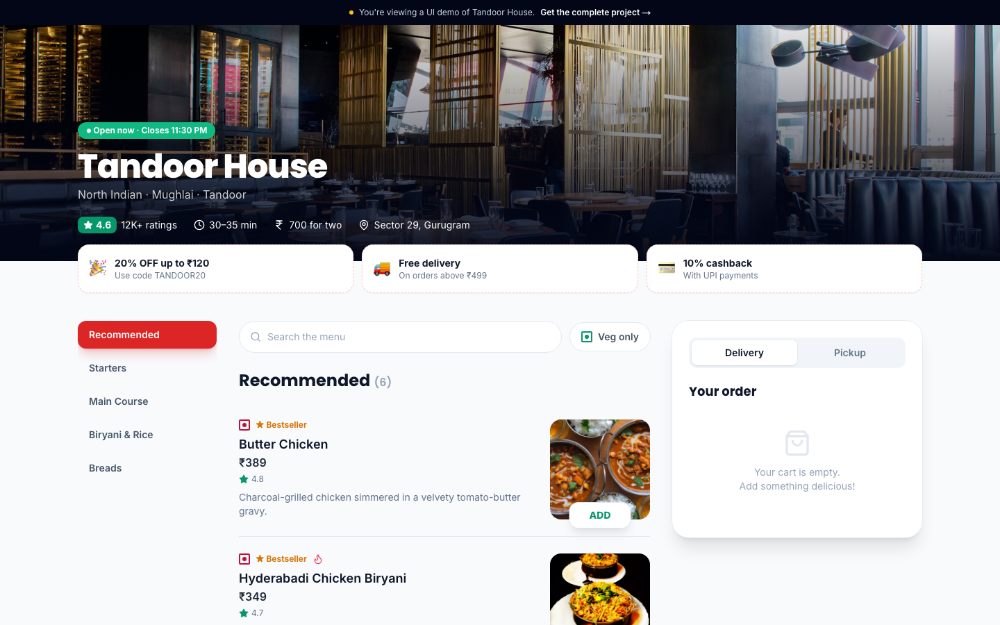
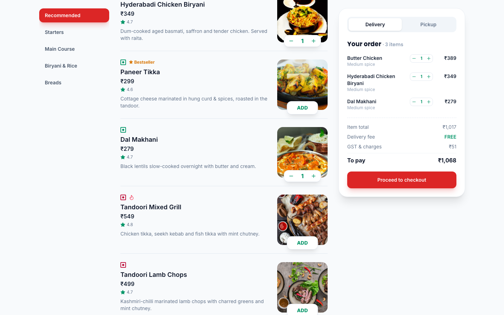
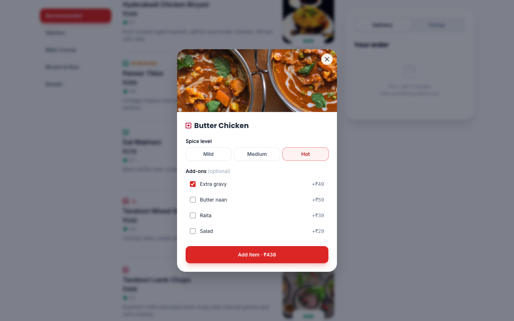
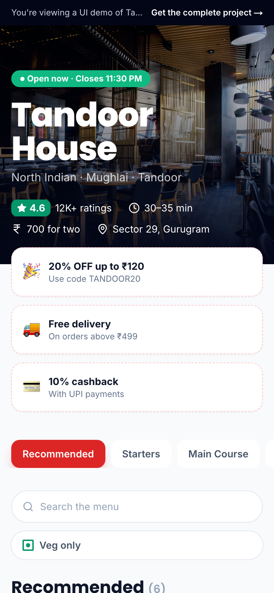

# Online Food Ordering System Development | Custom Food Ordering Software

**Naya Prayog Technologies** provides custom Online Food Ordering System Development services for restaurants, cafés, cloud kitchens, food businesses, and food-tech startups.

We help businesses build digital food ordering platforms where customers can explore menus, select food items, customize orders, place orders online, make payments, and track order progress.

Whether you want an online ordering website for a single restaurant or a larger food ordering platform, we can develop a solution around your business model and operational requirements.

---

## What Is an Online Food Ordering System?

An online food ordering system is a web or mobile application that enables customers to order food digitally instead of relying entirely on phone calls or in-person ordering.

A custom food ordering platform can connect customers with restaurant teams through a centralized order management workflow.

Depending on the project scope, the system can include:

- Customer-facing food ordering website
- Android and iOS food ordering applications
- Restaurant menu and category management
- Food customization and add-on options
- Shopping cart and checkout
- Online payment integration
- Order processing and status updates
- Pickup and delivery order management
- Customer accounts and order history
- Restaurant administration dashboard
- Offers, coupons, and promotional campaigns
- Sales and order analytics

## Key Features and Modules

### 1. Customer Food Ordering Website

Provide customers with an easy-to-use platform to discover food and place orders online.

Potential capabilities include:

- Customer registration and login
- Restaurant and food menu browsing
- Food categories and search
- Food item details and images
- Food variants and customization
- Add-ons and special instructions
- Shopping cart
- Order checkout
- Delivery address management
- Order confirmation
- Order history
- Customer profile management

### 2. Food Menu and Product Management

Manage food items, categories, prices, and availability.

Potential capabilities include:

- Food category management
- Menu item creation and editing
- Food images and descriptions
- Item pricing and offers
- Size and portion variants
- Extra toppings and add-ons
- Food availability management
- Vegetarian and non-vegetarian classifications
- Menu scheduling
- Featured and popular food items

### 3. Shopping Cart and Checkout

Make the ordering process convenient and straightforward.

Potential capabilities include:

- Add and remove food items
- Update item quantities
- Food customization
- Special cooking instructions
- Coupon and discount application
- Delivery charges
- Taxes and additional charges
- Order summary
- Address selection
- Checkout and order confirmation

### 4. Online Payment Integration

Enable digital payment options according to business and payment provider requirements.

Potential capabilities include:

- UPI payments
- Debit and credit cards
- Net banking
- Supported digital wallets
- Cash on delivery or pickup
- Payment status tracking
- Transaction records
- Refund workflows
- Payment gateway integration

Payment methods and automated payment workflows depend on the selected payment provider and integration scope.

### 5. Order Management System

Manage incoming orders from placement through completion.

Potential capabilities include:

- New order notifications
- Order acceptance and rejection
- Order preparation status
- Order confirmation
- Pending and completed orders
- Order cancellation workflows
- Order history
- Order search and filtering
- Customer and payment details
- Pickup and delivery order handling

### 6. Real-Time Order Tracking

Keep customers informed about the progress of their orders.

Potential capabilities include:

- Order confirmation updates
- Food preparation status
- Ready-for-pickup notifications
- Delivery status updates
- Delivery partner assignment
- Location-based tracking
- Estimated delivery information
- Push notifications

Live location tracking and estimated delivery features require suitable mapping, location, and notification integrations.

### 7. Restaurant Admin Dashboard

Give restaurant owners and administrators centralized control over the online ordering operation.

Potential capabilities include:

- Dashboard and business overview
- Menu and category management
- Food availability controls
- Order monitoring
- Customer management
- Coupon and discount management
- Payment records
- Sales reports
- Staff and role management
- Restaurant configuration
- Delivery settings

### 8. Customer Management and Engagement

Support customer relationships and repeat orders.

Potential capabilities include:

- Customer profiles
- Customer order history
- Saved addresses
- Favorite food items
- Customer feedback and reviews
- Promotional notifications
- Coupon management
- Loyalty and reward programs

### 9. Offers and Marketing Management

Support restaurant promotions and customer acquisition.

Potential capabilities include:

- Discount coupons
- Promotional campaigns
- Item-specific offers
- Category-based discounts
- First-order discounts
- Minimum-order offers
- Referral campaigns
- Loyalty rewards

### 10. Reports and Analytics

Monitor food ordering activity and business performance.

Potential reports include:

- Daily and monthly orders
- Total sales and revenue
- Popular food items
- Category-wise sales
- Customer order history
- Payment reports
- Cancelled orders
- Discount and coupon performance
- Order status summaries

---

## Types of Online Food Ordering Solutions

We develop food ordering platforms for different business models.

| Business Model | Potential Solution |
|---|---|
| Single Restaurant | Branded online food ordering website |
| Restaurant Chain | Multi-outlet food ordering platform |
| Café | Café ordering and pickup system |
| Cloud Kitchen | Online ordering and kitchen workflow |
| Fast Food Business | Quick-service food ordering application |
| Food Startup | Custom food ordering platform |
| Food Marketplace | Multi-restaurant ordering platform |
| Takeaway Business | Online pickup and pre-order system |

The platform architecture and modules depend on whether the business operates one restaurant, multiple branches, or a marketplace with independent restaurant vendors.

## Custom Food Ordering Software Development

Naya Prayog Technologies can develop tailored food ordering solutions based on your requirements.

Our development services include:

- Online Food Ordering Website Development
- Food Ordering App Development
- Restaurant Ordering System Development
- Custom Food Ordering Software
- Food Menu Management System
- Online Ordering and Checkout Solutions
- Restaurant Order Management System
- Food Pickup and Delivery Management
- Multi-Outlet Food Ordering Platforms
- Multi-Restaurant Ordering Marketplaces
- Food Ordering Admin Dashboard Development
- Payment Gateway and Third-Party API Integration

## Technology and Development Capabilities

Depending on the project requirements, we can use technologies such as:

| Technology | Application |
|---|---|
| Flutter | Android and iOS applications |
| React / Next.js | Customer websites and web dashboards |
| Node.js | Backend services and REST APIs |
| Python | Backend development and automation |
| MySQL / PostgreSQL | Relational database management |
| Firebase | Real-time application services and notifications |
| Cloud Infrastructure | Hosting, deployment, and scalability |

The final technology stack is selected according to the expected user traffic, business requirements, integrations, and maintenance needs.

## Why Choose Naya Prayog Technologies?

**Naya Prayog Technologies** is a software development and business automation company delivering custom digital solutions.

We work with entrepreneurs, restaurant owners, startups, and established businesses to develop software that supports their business workflows.

Our capabilities include:

- Custom web application development
- Android and iOS app development
- Backend and API development
- Admin dashboard development
- Payment gateway integration
- Business workflow automation
- Cloud deployment and technical support

We focus on building practical, scalable, and maintainable software around your business requirements.

## Our Development Process

1. **Requirement Analysis** – Understand your food business model and ordering workflow.
2. **Solution Planning** – Define customer, restaurant, and administrator requirements.
3. **UI/UX Design** – Plan the customer ordering experience and management interfaces.
4. **Development** – Build the web application, mobile applications, backend, and database.
5. **Testing** – Validate ordering, checkout, payments, and order management workflows.
6. **Deployment** – Configure infrastructure and deploy the agreed solution.
7. **Maintenance** – Provide ongoing support and improvements according to the project agreement.

## Frequently Asked Questions

### What is an online food ordering system?

An online food ordering system is a digital platform that allows customers to browse food menus, customize items, place orders, pay online or choose supported alternative payment methods, and receive order updates.

### Can you develop an online food ordering website for my restaurant?

Yes. We can develop a branded food ordering website with menu management, shopping cart, checkout, payment integration, and order management according to your requirements.

### Can you develop Android and iOS food ordering applications?

Yes. We can develop cross-platform mobile applications for Android and iOS, including customer-facing ordering applications and relevant management applications.

### Can the system support multiple restaurant branches?

Yes. Multi-outlet functionality can be included with branch-wise menus, order handling, administration, and reporting, depending on the agreed scope.

### Can customers pay online?

Yes. Supported payment gateways can be integrated to accept digital payments. Available payment methods depend on the selected provider.

### Can the system support both pickup and home delivery?

Yes. Pickup and delivery workflows can be developed according to the restaurant's operating model.

### Can you build a multi-restaurant food ordering platform?

Yes. A multi-restaurant platform can include restaurant registration, vendor dashboards, customer ordering, order distribution, and marketplace administration.

### How much does online food ordering system development cost?

The cost depends on the number of applications, features, user roles, integrations, restaurant branches, and project complexity. Contact our team to discuss your requirements and receive a project-specific estimate.

---

## Start Your Online Food Ordering Project

Looking to launch an online food ordering website, mobile application, or complete food ordering platform?

Partner with Naya Prayog Technologies to plan and develop a solution aligned with your business model.

**Naya Prayog Technologies**

Website: https://nayaprayog.com/

Portfolio: https://github.helloharendra.io

Email: [support@nayaprayog.com](mailto:support@nayaprayog.com)

Phone / WhatsApp: [+91 7991327022](https://wa.me/917991327022)

**Online Food Ordering | Restaurant Applications | Food Delivery Software | Custom Web & Mobile Development**

---

## Repository Purpose

This repository represents the online food ordering system development services and solution capabilities offered by Naya Prayog Technologies.

The features described are potential development capabilities, not a representation that every module is already implemented in a ready-to-deploy product. Final functionality depends on the agreed project scope.

## Proprietary Notice

This repository is maintained by Naya Prayog Technologies for service presentation, portfolio, and business development purposes.

Unless explicitly stated otherwise in a separate written agreement, the materials, branding, documentation, and proprietary content in this repository may not be copied, redistributed, or commercially reused without permission.

<!-- screenshots -->
## Screenshots

**Home**

<table>
  <tr>
    <td align="center" width="50%"><b>Menu</b>  </td>
    <td align="center" width="50%"><b>Dish Customisation</b>  </td>
  </tr>
</table>

<table>
  <tr>
    <td align="center" width="260"><b>Mobile View</b>  </td>
  </tr>
</table>
